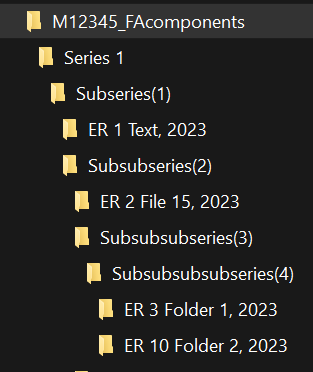
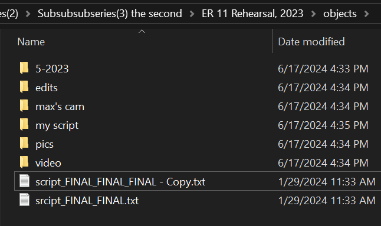
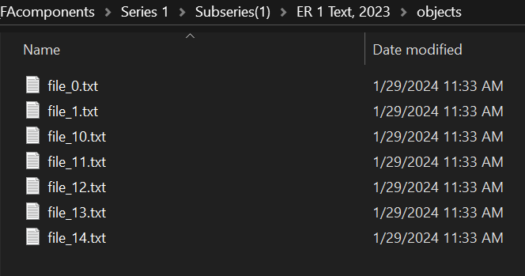

This page provides examples of Finding Aid Component folder structures that you  
might create when arranging electronic records. These examples should help you  
understand your options when arranging electronic records.  

* Arrangement hierarchy with Series and Subseries  
  
* ER objects folder with collection folders and files  
  
* ER objects folder with files only  
  
