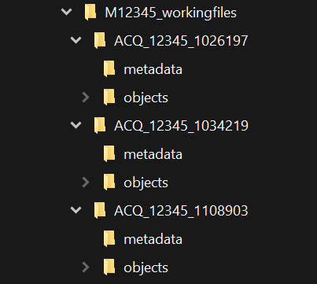
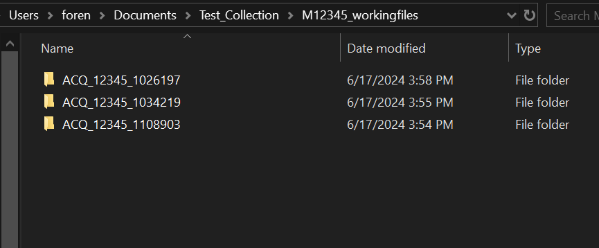
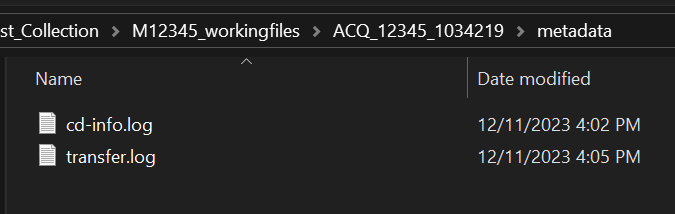
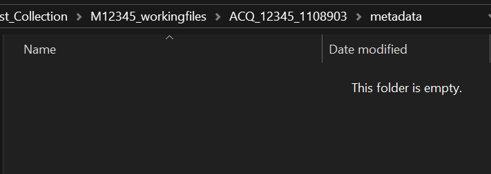
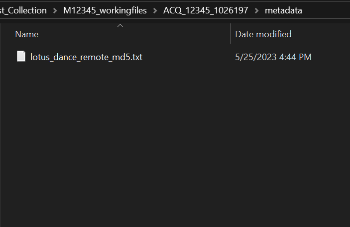
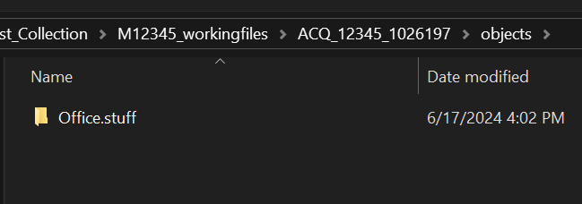
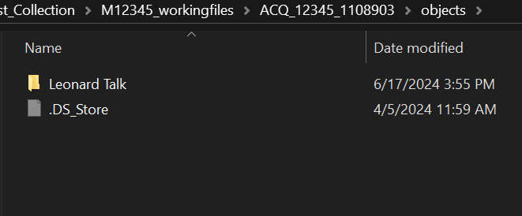
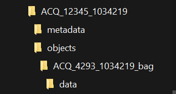
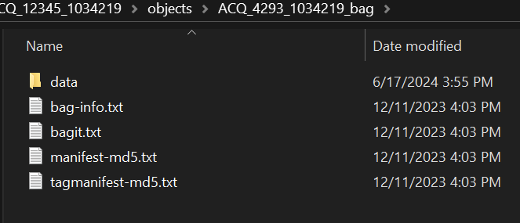

# Navigating the Drive

This page provides examples of the Media ID folder structures you may encounter when  
surveying Electronic Records at your workstation. These examples should help you  
understand what folders contain collection material, what folders contain metadata,  
and when there might be a transfer issue.   

* Working files collection folder with ACQ Media ID folders within (tree view)  
  
* ACQ Media ID folders within working files collection folder (folder view)  
  
* Contents of metadata folder for optical media transfers, cd-info and transfer logs  
  
* Rsync metadata folder (empty)  
  
* Remote transfer metadata folder (md5.txt checksum file)  
  
* Objects folder containing collection material  
  
* Objects folder containing system files  
  
* Bagit folder tree with data folder (collection material within data folder)  
  
* Contents of ACQ ID bag folder (metadata files created by bagit)  
  