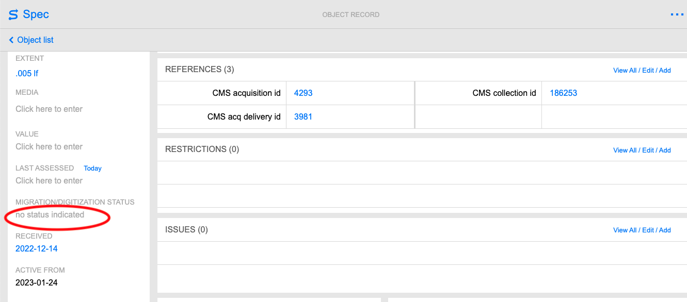
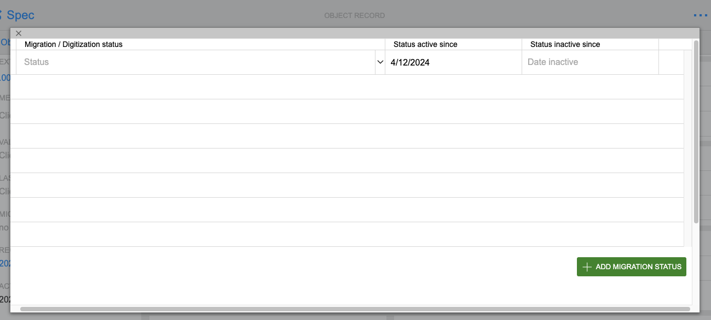
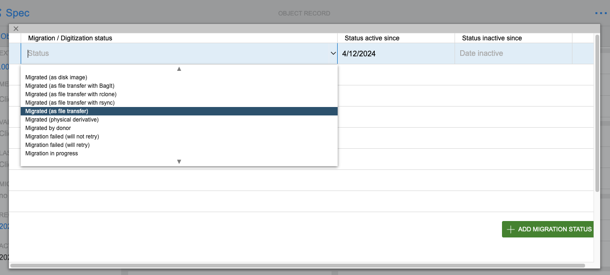

# Completing Transfer <!-- (digarch issue 87) -->
This page outlines the steps to take after transferring media.  
* Verifying all carriers were transferred
* Verifying all packages meet requirements    
* Verifying all SPEC records were updated
* Storing the carriers and updating Location

## Verifying all carriers were transferred
* Note when carrier transfer fails  
* Note when carriers are identified as AMI
  * Update objects in SPEC
  * Send carriers to Audio and Moving Image Description  
  
(Refer to transfer instructions for the format you are transferring)

## Verifying all packages meet requirements
Under Construction
{: .label .label-yellow}  
* Run the packaging script

## Updating records in SPEC
* Navigate to objects records for an acquisition in SPEC (see [verifying acquisition](preparing-for-transfer.md#verifying-acquisition-record-exists-in-spec))  
* Select an object record to update
* Select no status indicated under MIGRATION/DIGITIZATION STATUS on the left  

Select to view image

  

* Select Add Migration Status

Select to view image

  

* Select a status from the dropdown  

Select to view image

  

* Select a date  

## Storing the carriers
* Return carriers to shelving by the entrance door
* Place carriers on `02.**` or `03.**` shelves as space allows
* Update the carriers' location in Trello using the Location Custom Field
* Update the carriers' location in SPEC

