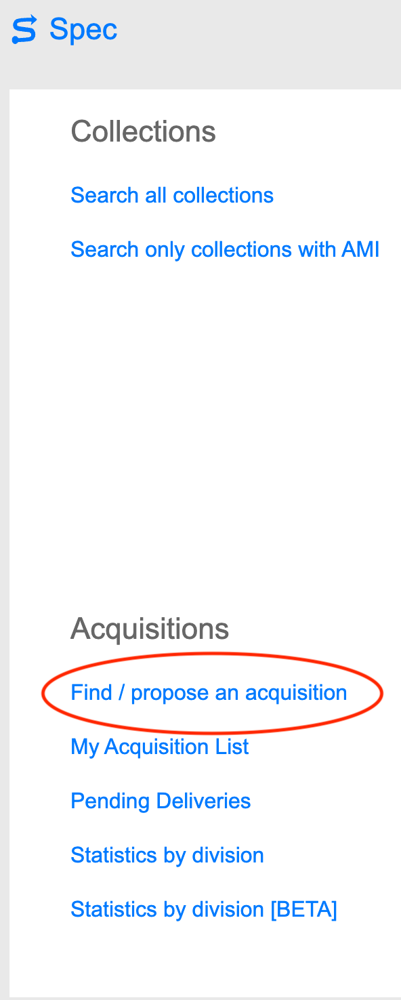
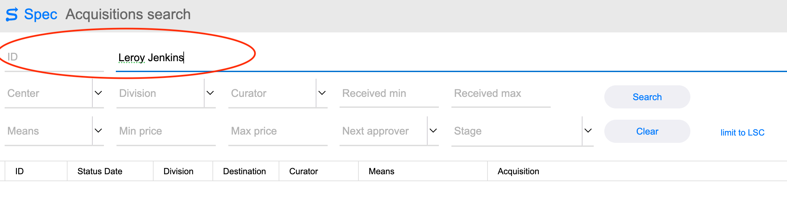
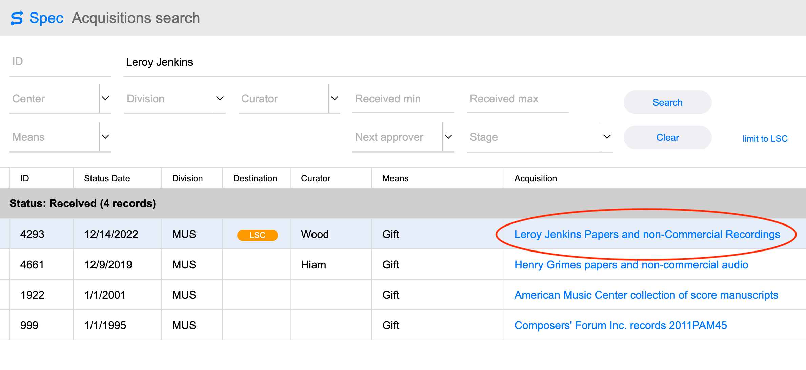
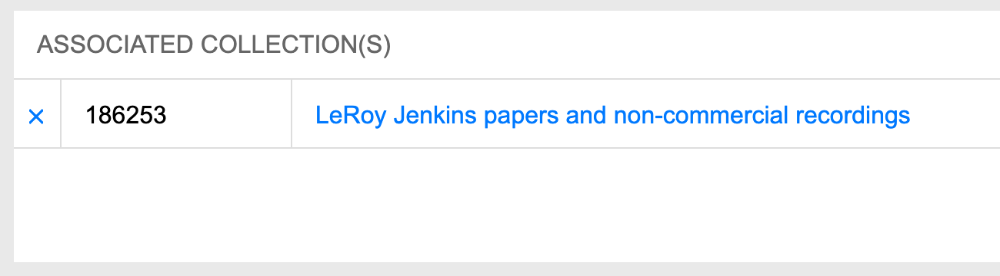
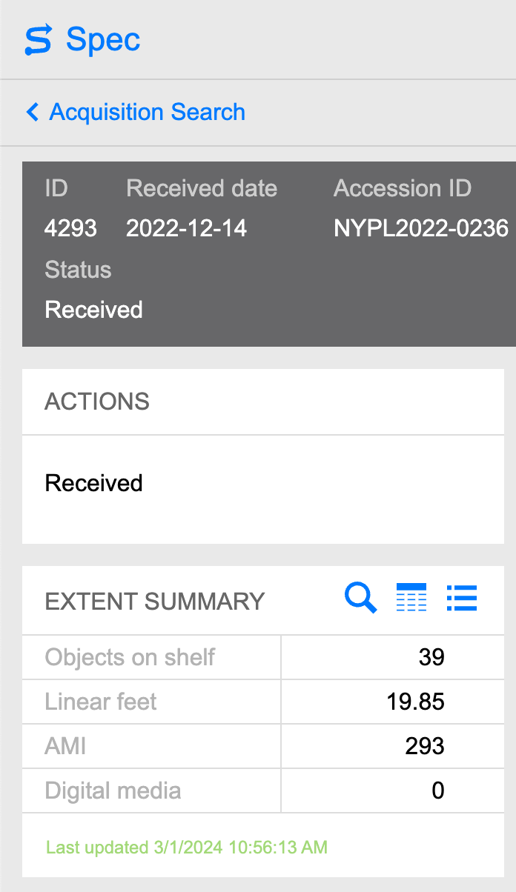
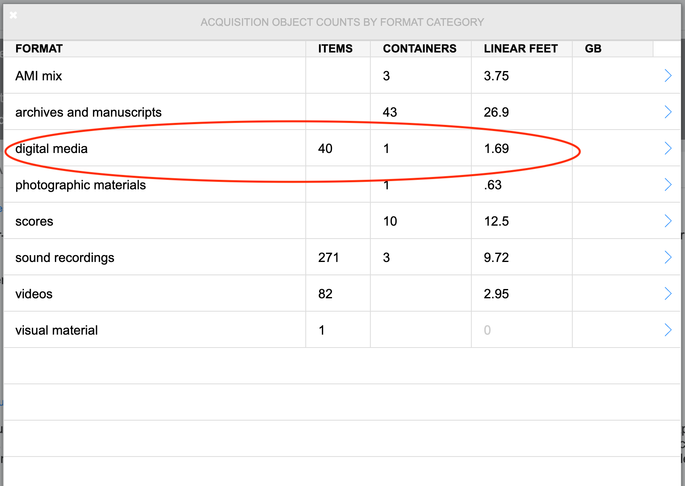
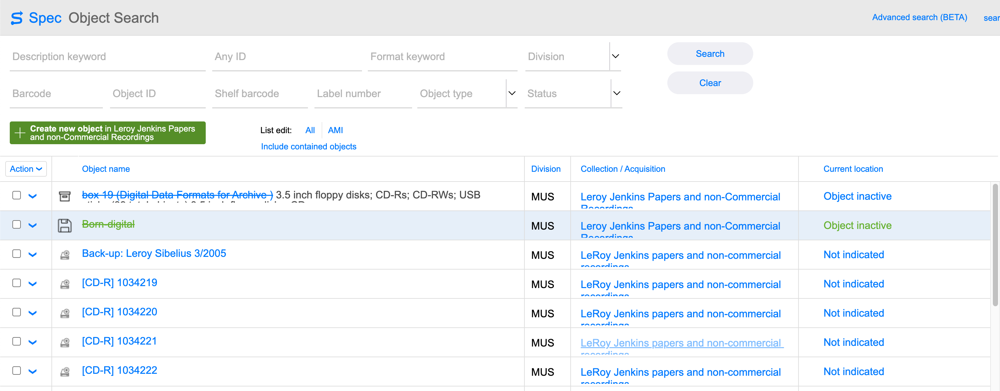
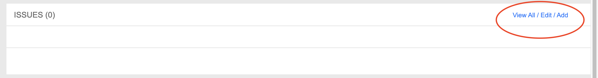
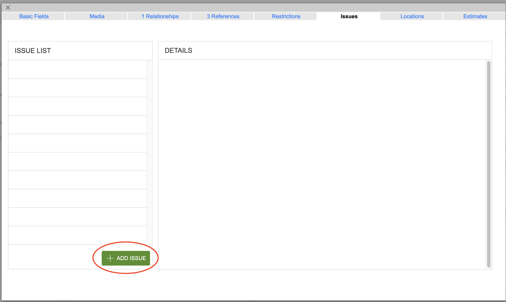
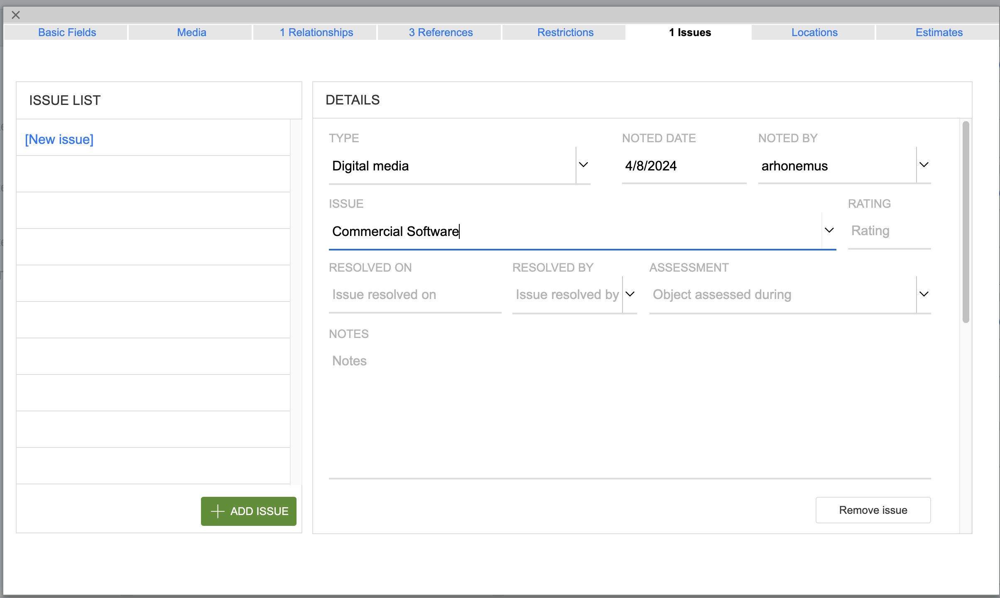

# Preparing for Transfer <!-- (digarch issue 79) -->
This page outlines the steps to take before transferring media objects.
* Locating and verifying carriers against SPEC records
* Removing non-digital archives carriers
    * Commercial software
    * AMI (addressed in [completing transfer](completing-transfer.md))
* Choosing transfer methods
* Setting up space to store files on RAID

## Locating Carriers
* Carriers are located on shelving by the entrance door
* Carriers to be transferred are likely on `02.**` shelves
* 
**Before a media object can be imaged it first must be recorded SPEC.**

## Verifying SPEC records
An acquisition record should exist in SPEC and SPEC object records should exist   
for each carrier being transferred.  

### Verifying acquisition record exists in SPEC
* Use the Filemaker Pro desktop app or or [web app](https://fm.nypl.org/fmi/webd/CollectionInfo) to access SPEC
* Log in with your credentials  
* Navigate to the bottom left of the screen  
* Select Find/propose an acquisition under Acquisitions heading  

Select to view image

* Enter acquisition number in the ID field or name in the Acquisition field  

Select to view image

* Select search  

**Contact Collection Management if you cannot find the acquisition**

### Verifying object records exist in SPEC
* Select the acquisition from the list  

Select to view image

* Note if there are any associated collections  

Select to view image

* Navigate to the left side of the screen  
* Note the number of items listed for Digital media under Extent Summary   

Select to view image

* Select format summary next to Extent Summary, the right most button

* Select digital media, mouseover text reads go to object records  

Select to view image

* Confirm the number of carriers Digital Archives has match the object records  

Select to view image

* Confirm the number of items listed for Digital media matches the object records  
* Report mismatch of digital media summary and object records to Systems and Operations  

**Contact Collection Management if the number of carriers and records don't match**

### Verifying additional carriers from Archival Processing
When archivists survey a collection they may find additional carriers in boxes.  
Archivists should create object records for any carriers they find and notify  
Digital Archives of their discovery.  
* [Verify](#verifying-object-records-exist-in-spec) objects records exist in SPEC  

**Contact the processing archivist if the number of carriers and records don't match**  

### Handling Commercial Software  
**These instructions are for Digital Preservation staff (including fellows) only.**
* Label commercial software with a simple acquisition name.
    * `Crouch` for Stanley Crouch papers.
* Image commercial software only when specifically instructed to do so.  
* Commercial software media don't receive objects records.  

**When objects records were created for commercial software create an issue.**

* Select issues from the object record menu in SPEC

Select to view image

* Select Add Issue

Select to view image

* Select Type: Digital Media
* Enter Issue: Commercial Software

Select to view image

## Choosing Transfer Methods
File transfer is the most common method of migrating files to more stable storage.  
Disk imaging is done when an image is required to access files, usually for emulation  
of legacy file types.  

File transfer methods include:
* Rsync
* Bagit
* Mass Optical Disc File Transfer with Nimbie (creates bags and other transfer metadata)  
* Cloud Transfer - Rclone
* FTK Imager File Export
* IsoBuster File Export

Disk Imaging methods include:
* Kryoflux Imaging
* FTK Imager
* dd

### Choosing Transfer Method by Carrier

Digital Archives has a standard transfer method for most of the carrier types we  
encounter. Generally, carriers will be transferred with the standard method unless  
standard methods fail.  

|       Carrier       |             Transfer             |
|:-------------------:|:--------------------------------:|
| External Hard Drive |           File Transfer          |
| Internal Hard Drive |           File Transfer          |
|     Thumb Drive     |           File Transfer          |
|       SD Card       |           File Transfer          |
|    Optical Media    |    Mass Optical Disc Transfer    |
|     Floppy Disk     |  Floppy Disk Imaging - Kryoflux  |
|     Iomega Disk     | Iomega Disk Imaging - FTK Imager |
|     Google Drive    |   Cloud File Transfer - Rclone   |

## Verifying Storage Space
Before beginning transfer make sure Digital Archives Diskstation (DADS) has enough  
space to store the transfers.  